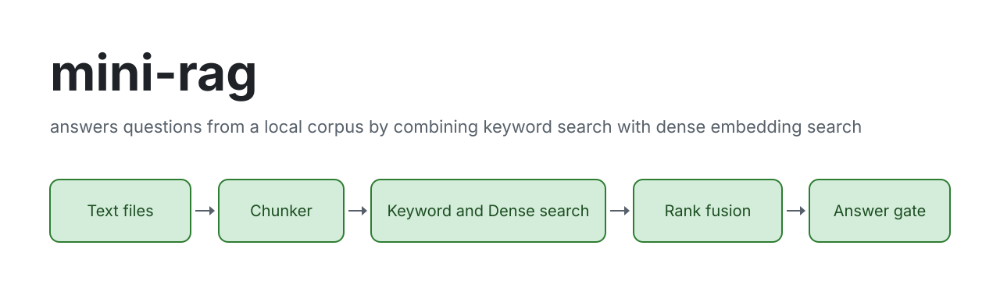
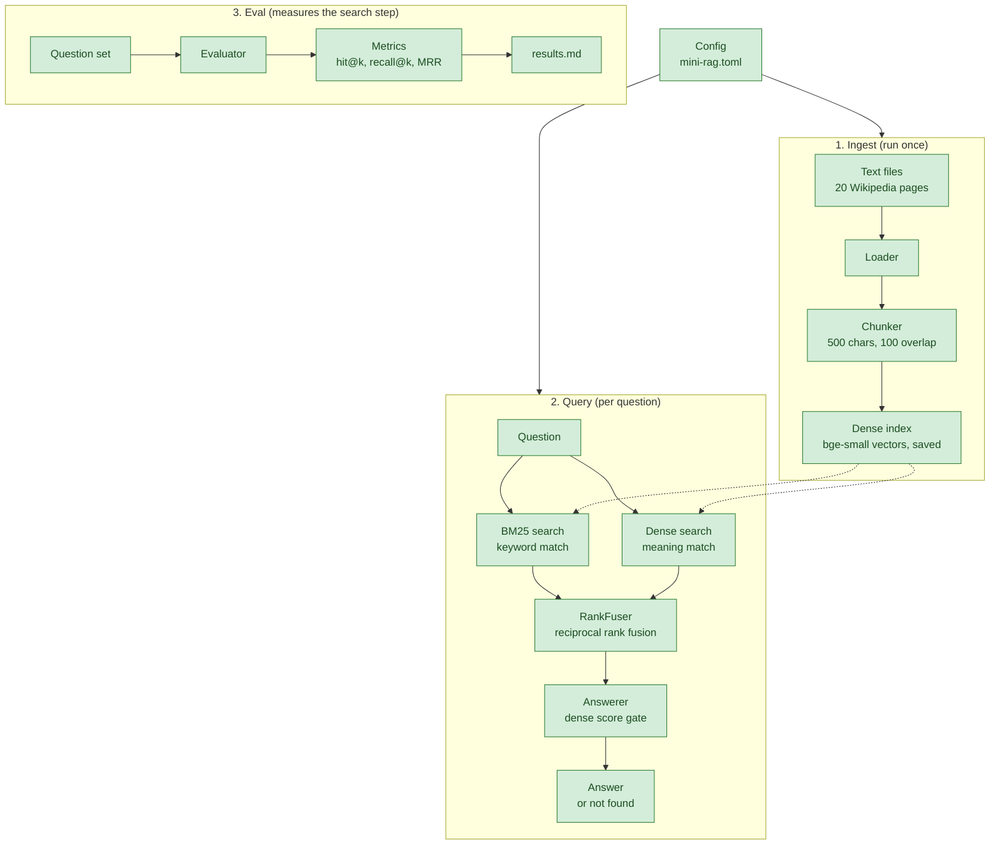

# mini-rag

<picture>
  <source media="(prefers-color-scheme: dark)" srcset="assets/readme/hero-dark.svg">
  
</picture>

[Setup](#setup) · [Usage](#usage) · [Make your own](#make-your-own-mini-rag) · [Contributing](#contributing) · [Decisions](docs/decisions.md)

mini-rag answers questions from a small local corpus of 20 English Wikipedia articles by combining keyword search (BM25) with dense embedding search. It shows the retrieved passages and only answers when the best match is close enough, so a question the corpus can't answer gets "Not found in the corpus." instead of a guess.

### Limits at a glance

1. The eval set holds 31 questions (25 answerable, 6 unanswerable), written by the project author after reading the source sentences. 14 of the 25 answerable questions share at most 40 percent of their words longer than 3 characters with the source sentence. A difference of 2 questions or fewer between two setups is inside the noise ([D17](docs/decisions.md#d17-question-set), [D22](docs/decisions.md#d22-fusion-tuning)).
2. At chunk size 500, dense search alone found the relevant chunk in its top 5 for 21 of the 25 answerable questions and hybrid search for 19. At chunk size 1000 the counts are 21 and 22. Hybrid stays the default ([D22](docs/decisions.md#d22-fusion-tuning)).
3. The shipped threshold 0.55 belongs to `BAAI/bge-small-en-v1.5`. In one measurement with `minishlab/potion-base-8M`, `calibrate` gave its lowest error count at 0.35, 0.40 and 0.45, and at 0.55 it counted 8 of the 25 answerable questions as rejected ([D28](docs/decisions.md#d28-per-model-threshold-and-calibration), [D29](docs/decisions.md#d29-fresh-clone-test)).
4. The three on-topic unanswerable questions have best dense scores from 0.656 to 0.733 at chunk size 500, inside the answerable range of 0.648 to 0.890, so no threshold separates them without rejecting answerable questions ([D23](docs/decisions.md#d23-threshold-decision)).
5. The corpus is 20 English Wikipedia pages stored as plain text, and the plain-text extracts drop tables ([D11](docs/decisions.md#d11-wikipedia-corpus)).
6. The default test suite makes no network call, and no test sends a request to a hosted generation service ([D13](docs/decisions.md#d13-test-strategy)).

## How it works

Ingest runs once. It reads the text files in `data/corpus`, cuts them into overlapping 500-character chunks, embeds every chunk with the `BAAI/bge-small-en-v1.5` model and saves the vectors and chunks to `.cache/index`.

A query loads that index and searches it twice. BM25 finds chunks that share words with the question, and dense search finds chunks whose meaning is close to it. Reciprocal rank fusion merges the two rankings into one list. The answerer then checks the best dense (cosine) score among the returned hits against a threshold. Below it, the answer is "not found". Above it, the answer is the retrieved chunk texts, each with a citation marker such as `[tokamak#94]`. With `--generate`, a language model writes the answer from those chunks instead.

The `eval` command measures retrieval on a hand-written question set. It compares BM25, dense and hybrid search at two chunk sizes and sweeps the gate threshold. The numbers from the last run are in [eval/results.md](eval/results.md).

## Status



Legend: green means built and merged, yellow means not built yet.

## Setup

You need [uv](https://docs.astral.sh/uv/) installed. uv runs the project with the Python version pinned in `.python-version` (3.13), and `pyproject.toml` requires Python 3.13 or later. uv installing Python itself wasn't tested ([D29](docs/decisions.md#d29-fresh-clone-test)).

The commands in this README were run on Windows with Windows PowerShell 5.1. `scripts\env.ps1` is a PowerShell script only. No test has run on Linux or macOS.

1. Open a PowerShell window in the project root.
2. Dot-source the environment script with `. .\scripts\env.ps1` so the model caches stay inside `.cache` for this session.
3. Install the dependencies with `uv sync`.
4. Run the test suite with `uv run pytest`.

```powershell
. .\scripts\env.ps1
uv sync
uv run pytest
```

The expected output ends with `368 passed, 1 deselected`. The slow test is deselected by default; `uv run pytest -m slow` runs it.

Every command reads its settings from `mini-rag.toml` in the project root: the corpus folder, chunking, embedding model, retrieval, threshold, generator and eval files. The shipped file reproduces the included example, and a command-line option overrides the matching value in it. Use `--config PATH` to read another file.

The default test run downloads nothing. The first `ingest` downloads the quantised embedding model into `.cache\fastembed`; the model folder is 64.1 MB (67,181,330 bytes). Later runs reuse it. In a test on a fresh clone, the first ingest printed a warning that no Hugging Face token was set and, on Windows, a warning that symlinks are unavailable. The run succeeded anyway.

## Usage

Build the index from `data/corpus` (the defaults are `--corpus data/corpus`, `--index-dir .cache/index`, `--size 500` and `--overlap 100`):

```powershell
uv run mini-rag ingest
```

On the included corpus this reports 20 documents and 1,741 chunks.

Ask a question:

```powershell
uv run mini-rag query "Who won the 1998 football World Cup?"
```

Each hit prints its rank, its marker, its dense, BM25 and fused scores, and the chunk text. A `-` means that retriever didn't return the chunk. The real output for this question starts like this (chunk texts left out):

```text
1. [nuclear_safety_and_security#82]  dense 0.502  bm25 14.754  fused 0.0313
2. [chernobyl_disaster#158]  dense 0.495  bm25 8.279  fused 0.0288
3. [chernobyl_disaster#145]  dense 0.528  bm25 -  fused 0.0164
4. [tokamak#94]  dense -  bm25 12.990  fused 0.0161
5. [chernobyl_disaster#6]  dense 0.520  bm25 -  fused 0.0161
```

The output ends with the answer and a line such as `found: no, written by a model: no`.

Query options:

- `--index-dir DIR` sets the folder the index is read from (default `.cache/index`).
- `--top-k N` sets how many fused hits to return (default 5).
- `--threshold F` sets the dense score the best hit must reach to count as found (default 0.55, allowed range -1.0 to 1.0). The best dense score among the hits above is 0.528, so the default reports the question as not found. That's the right result, because no article in the corpus mentions the World Cup. With `--threshold 0.5` the same question is answered.
- `--generate` asks a language model to write the answer from the retrieved chunks.
- `--brief` cuts each hit's text to 160 characters and adds `...` when it was cut. The extractive answer below the hits is still printed in full.
- `--mode MODE` picks the retrieval mode: `hybrid` (default), `dense` or `bm25`. Dense and bm25 modes print `-` in the fused column. In bm25 mode the threshold isn't applied, and a note says so. `calibrate` takes the same option. The mode is set under `[retrieval] mode` in `mini-rag.toml`, and `--mode` overrides it; [docs/make-your-own.md](docs/make-your-own.md#choose-a-retrieval-mode) compares the modes.

Generation is off by default. Without `--generate` the answer is extractive: the retrieved chunk texts under their markers. The shipped `mini-rag.toml` sets `[generator] kind = "none"`, so `--generate` prints `note: no generator is configured ([generator] kind is "none"); showing the extractive answer` and then the extractive answer.

To let a model write the answer through the Anthropic API:

1. Install the optional package with `uv sync --extra llm`.
2. Replace the `kind` and `model` lines of the `[generator]` section in `mini-rag.toml` with the block below, putting your provider's model name in place of the placeholder.
3. Set the key in the PowerShell session that runs the query with `$env:ANTHROPIC_API_KEY = "<your key>"`.

```toml
[generator]
kind = "anthropic"
model = "<model name from your provider>"
```

With kind `"anthropic"` and no `model`, every command stops with exit code 2 and `error: [generator] model is required for kind "anthropic"; set it to the model name from your provider`. If the key isn't set or the package is missing, `query --generate` prints a note and shows the extractive answer. [docs/make-your-own.md](docs/make-your-own.md#swapping-the-generator) covers the other generator kinds.

Run the evaluation:

```powershell
uv run mini-rag eval
```

The command reads `eval/questions.json` and checks every question against the corpus. It then compares BM25, dense and hybrid retrieval at chunk sizes 500 and 1000, prints the metrics table and the threshold sweep, and writes the full report to `eval/results.md`.

Eval options:

- `--sizes 500,1000` sets the chunk sizes to compare.
- `--build-only` embeds the corpus for each size, saves the result under `.cache/eval` and stops there. It loads no questions and writes no report. A later run with the same corpus and settings loads that cache instead of embedding again.
- `--rebuild` ignores the cache and embeds again.
- `--out PATH` changes where the report is written.
- `--fusion-grid` also evaluates hybrid search under 12 fusion settings (k of 5, 10, 20 or 60, each with a BM25 weight of 1.0, 0.5 or 0.25) and writes `fusion_grid.md` next to the report. It first prints whether each index was loaded from the cache or built. The last grid run is in [eval/fusion_grid.md](eval/fusion_grid.md).

Embedding is the slow part. In the fresh-clone test, `eval --build-only` took 156.1 s and 161.4 s for the two chunk sizes ([D29](docs/decisions.md#d29-fresh-clone-test)). Those times come from one machine; no other CPU was measured.

## Make your own mini-rag

mini-rag is also a template. Edit `mini-rag.toml` to point it at your own folder of text files, a different embedding model and a different answer-writing model, then run `ingest` and `query` as above. Four commands help you build a small question set for your corpus and calibrate the threshold: `eval-init`, `eval-suggest`, `eval-check` and `calibrate`. The threshold belongs to the configured embedding model, so calibrate it again after you change the model. [docs/make-your-own.md](docs/make-your-own.md) walks through every step.

## Known limits

- The default threshold of 0.55 was picked from the sweep in [eval/results.md](eval/results.md), which counts the errors at each threshold from 0.40 to 0.80. It is tuned on the questions it is measured on, so it will look better there than on new questions. At chunk size 500 it sits only 0.022 above the highest off-topic score in the set.
- The gate can't reject an on-topic question the corpus doesn't answer. The three on-topic unanswerable questions in the eval set have best dense scores of 0.656 to 0.733 at chunk size 500, inside the answerable range of 0.648 to 0.890, and all three are accepted. The dense score measures how close the topic is, not whether the answer is present, so no threshold on it separates them.
- On this question set hybrid search is no better than dense search alone. With the default fusion settings (k = 60, both weights 1.0), hybrid finds 19 of 25 answers in its top 5 at chunk size 500 against 21 for dense, and 22 against 21 at size 1000. None of the 12 settings in [eval/fusion_grid.md](eval/fusion_grid.md) improved on the defaults by more than the noise, so they are unchanged. No other corpus and no question set built on exact keywords was tested.
- The sweep covers top-k 5 only.
- The gate reads the best dense score among the returned hits, so the result depends on `--top-k`. A larger top-k can bring in a chunk with a higher dense score.
- Wikipedia's plain-text extracts drop tables, and formulas lose their layout. In `data/corpus/nuclear_fusion.txt`, "in the following table." is followed by an empty line, and `data/corpus/plasma_physics.txt` shows the ionisation fraction as `α=nini+nn`.
- The evaluation uses 25 answerable and 6 unanswerable hand-written questions. With so few, a difference of 1 to 2 questions between two setups is noise. Hand-written questions also tend to reuse words from the source text, which favours keyword search.
- The unanswerable set is small. One question is a sixth of it, so a single question moves the acceptance rate by 16.7 percentage points.

## Contributing

1. Open an issue with the Feature request or Bug report template.
2. Fork the repository, create a branch, and make the change together with its tests and the documentation updates.
3. Open a pull request whose title and description follow the format in [CONTRIBUTING.md](CONTRIBUTING.md#pull-request-title-and-description).

[CONTRIBUTING.md](CONTRIBUTING.md) holds the full rules.

## License

The code is under the MIT License (see `LICENSE`, Copyright (c) 2026 Avan Dave (Avan Avi)). The corpus texts in `data/corpus` are English Wikipedia articles licensed under CC BY-SA 4.0; see `data/corpus/SOURCES.md` for each article's source and revision.

## More documentation

- [docs/decisions.md](docs/decisions.md) logs each design decision with its reasons and trade-offs.
- [docs/flow.md](docs/flow.md) walks through ingest, query and eval with the classes, data types, scores and file locations.
