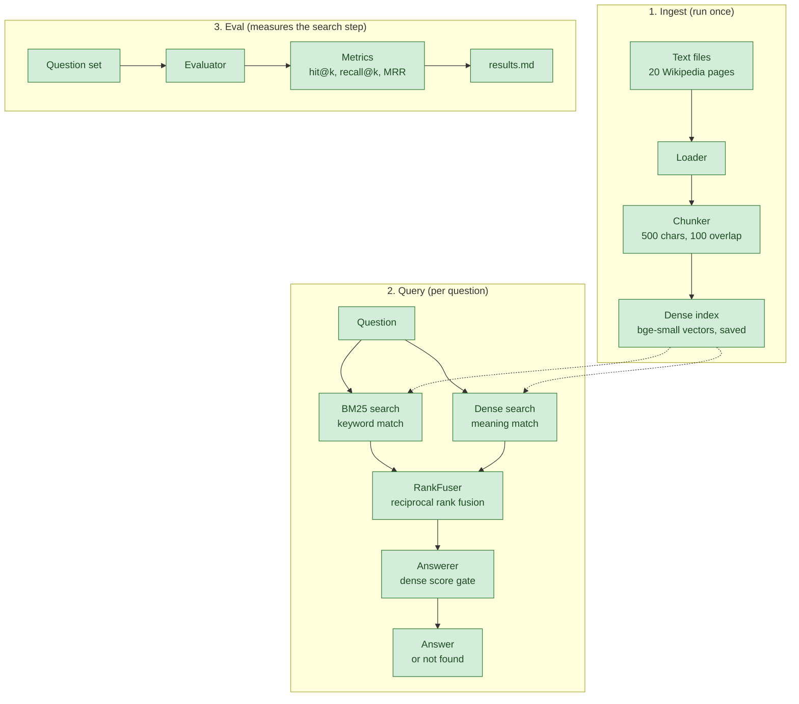

# mini-rag

mini-rag answers questions from a small local corpus of 20 English Wikipedia articles by combining keyword search (BM25) with dense embedding search. It shows the retrieved passages and only answers when the best match is close enough, so a question the corpus can't answer gets "Not found in the corpus." instead of a guess.

## How it works

Ingest runs once. It reads the text files in `data/corpus`, cuts them into overlapping 500-character chunks, embeds every chunk with the `BAAI/bge-small-en-v1.5` model and saves the vectors and chunks to `.cache/index`.

A query loads that index and searches it twice. BM25 finds chunks that share words with the question, and dense search finds chunks whose meaning is close to it. Reciprocal rank fusion merges the two rankings into one list. The answerer then checks the best dense (cosine) score among the returned hits against a threshold. Below it, the answer is "not found". Above it, the answer is the retrieved chunk texts, each with a citation marker such as `[tokamak#94]`. With `--generate`, a language model writes the answer from those chunks instead.

The `eval` command measures retrieval on a hand-written question set. It compares BM25, dense and hybrid search at two chunk sizes and sweeps the gate threshold. The numbers from the last run are in [eval/results.md](eval/results.md).

## Status



Legend: green means built and merged, yellow means not built yet.

## Setup

These steps use Windows PowerShell. You need [uv](https://docs.astral.sh/uv/) installed; the project pins Python 3.13 in `.python-version`.

1. Open a PowerShell window in the project root.
2. Dot-source the environment script with `. .\scripts\env.ps1` so the model caches stay inside `.cache` for this session.
3. Install the dependencies with `uv sync`.
4. Run the test suite with `uv run pytest`.

```powershell
. .\scripts\env.ps1
uv sync
uv run pytest
```

The default test run downloads nothing. The first `ingest` downloads the quantised embedding model, about 64 MB, into `.cache\fastembed`. Later runs reuse it.

## Usage

Build the index from `data/corpus` (the defaults are `--corpus data/corpus`, `--index-dir .cache/index`, `--size 500` and `--overlap 100`):

```powershell
uv run mini-rag ingest
```

On the included corpus this reports 20 documents and 1,741 chunks.

Ask a question:

```powershell
uv run mini-rag query "Who won the 1998 football World Cup?"
```

Each hit prints its rank, its marker, its dense, BM25 and fused scores, and the chunk text. A `-` means that retriever didn't return the chunk. The real output for this question starts like this (chunk texts left out):

```text
1. [nuclear_safety_and_security#82]  dense 0.502  bm25 14.754  fused 0.0313
2. [chernobyl_disaster#158]  dense 0.495  bm25 8.279  fused 0.0288
3. [chernobyl_disaster#145]  dense 0.528  bm25 -  fused 0.0164
4. [tokamak#94]  dense -  bm25 12.990  fused 0.0161
5. [chernobyl_disaster#6]  dense 0.520  bm25 -  fused 0.0161
```

The output ends with the answer and a line such as `found: yes, written by a model: no`.

Query options:

- `--top-k N` sets how many fused hits to return (default 5).
- `--threshold F` sets the dense score the best hit must reach to count as found (default 0.5, allowed range -1.0 to 1.0). The question above is answered at `--threshold 0.5` and reported as not found at `--threshold 0.6`, which is the right result because no article in the corpus mentions the World Cup.
- `--generate` asks a language model to write the answer from the retrieved chunks.
- `--brief` cuts each hit's text to 160 characters and adds `...` when it was cut.

Generation is opt-in. Without `--generate` the answer is extractive: the retrieved chunk texts under their markers. The optional feature uses generation with a language model through the Anthropic API. It needs the `llm` extra (`uv sync --extra llm`) and the `ANTHROPIC_API_KEY` variable already set in the PowerShell session. If the key isn't set or the package is missing, the command prints a note and shows the extractive answer.

Run the evaluation:

```powershell
uv run mini-rag eval
```

The command reads `eval/questions.json` and checks every question against the corpus. It then compares BM25, dense and hybrid retrieval at chunk sizes 500 and 1000, prints the metrics table and the threshold sweep, and writes the full report to `eval/results.md`.

Eval options:

- `--sizes 500,1000` sets the chunk sizes to compare.
- `--build-only` embeds the corpus for each size, saves the result under `.cache/eval` and stops there. It loads no questions and writes no report. A later run with the same corpus and settings loads that cache instead of embedding again.
- `--rebuild` ignores the cache and embeds again.
- `--out PATH` changes where the report is written.

Embedding is the slow part. In one run on a CPU, `--build-only` took 160 seconds for size 500 (1,741 chunks) and 154 seconds for size 1000 (780 chunks).

## Known limits

- The default threshold of 0.5 is unchanged, and the unanswerable question above passes it. The sweep in [eval/results.md](eval/results.md) counts the errors at each threshold from 0.40 to 0.80.
- A threshold chosen from the sweep is tuned on the questions it is measured on, so it will look better there than on new questions.
- The sweep covers top-k 5 only.
- The gate reads the best dense score among the returned hits, so the result depends on `--top-k`. A larger top-k can bring in a chunk with a higher dense score.
- Wikipedia's plain-text extracts drop tables, and formulas lose their layout. In `data/corpus/nuclear_fusion.txt`, "in the following table." is followed by an empty line, and `data/corpus/plasma_physics.txt` shows the ionisation fraction as `α=nini+nn`.
- The evaluation uses 25 answerable and 6 unanswerable hand-written questions. With so few, a difference of 1 to 2 questions between two setups is noise. Hand-written questions also tend to reuse words from the source text, which favours keyword search.
- The unanswerable set is small. One question is a sixth of it, so a single question moves the acceptance rate by about 17 percentage points.

## License

The code is under the MIT License (see `LICENSE`, Copyright (c) 2026 Avan Dave (Avan Avi)). The corpus texts in `data/corpus` are English Wikipedia articles licensed under CC BY-SA 4.0; see `data/corpus/SOURCES.md` for each article's source and revision.

## More documentation

- [docs/decisions.md](docs/decisions.md) logs each design decision with its reasons and trade-offs.
- [docs/flow.md](docs/flow.md) walks through ingest, query and eval with the classes, data types, scores and file locations.
