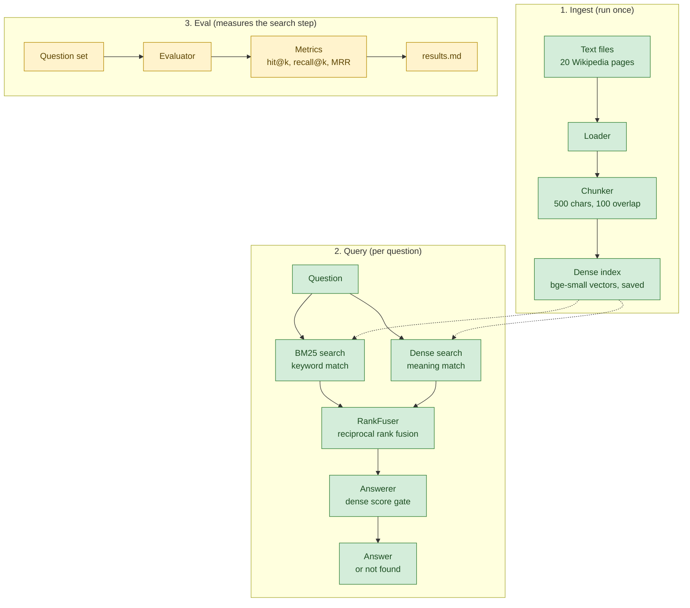

# How mini-rag works

This is a guided tour of the code: what runs during ingest, query and eval, which data types move between the steps, what each score means, and where files live. Class and method names refer to `src/mini_rag`. The reasons behind each choice are in [decisions.md](decisions.md).

## Overview



Legend: green means built and merged, yellow means not built yet. The dotted lines show that both searches read the saved index.

## 1. Ingest

`uv run mini-rag ingest` calls `Cli.ingest`, which runs these steps in order:

1. `Chunker(i_size, i_overlap)` validates the chunk settings first, so bad values fail before any work is done.
2. `Loader(s_corpus_dir).load()` reads every non-empty `.txt` file in `data/corpus` in file name order and returns one `Document` per file. Line endings are normalised to `\n`.
3. `Chunker.chunk_documents()` cuts every document into `Chunk` objects of 500 characters, each starting 400 characters after the last. On the included corpus that's 20 documents and 1,741 chunks.
4. `DenseIndex.build()` embeds all chunk texts through `FastEmbedEmbedder.embed()` and stores them as L2-normalised float32 rows in `arr_vectors`.
5. `DenseIndex.save()` writes `vectors.npy` and `chunks.json` into `.cache/index`.

Finally, `Cli.ingest` prints the counts, the settings, the index folder and the elapsed time. A missing corpus folder or an invalid setting prints an error and exits with code 2.

## 2. Query

`uv run mini-rag query "<question>"` calls `Cli.query`:

1. `DenseIndex.load()` reads `.cache/index` and checks the model name, the 2-D shape and the row count.
2. `Bm25Index.build()` rebuilds the keyword index from the loaded chunks. It isn't saved separately.
3. `Answerer(f_threshold)` is created before searching, so an invalid `--threshold` fails early.
4. `HybridRetriever.search(question, top_k)` asks each index for `max(20, top_k)` candidates: `Bm25Index.search()` tokenises the question with `Tokenizer` and keeps hits with a positive score, and `DenseIndex.search()` embeds the question with `query_embed()` and ranks every chunk by cosine score.
5. `RankFuser.fuse()` merges the two lists with reciprocal rank fusion. `HybridRetriever` then attaches each chunk's own dense and BM25 score and keeps the first `top_k` hits as `HybridHit` objects.
6. `Cli.print_hit()` prints every hit with its marker and its three scores.
7. `Cli.answer()` picks the answerer. With `--generate`, `Cli.make_client()` returns an `LlmClient` if `ANTHROPIC_API_KEY` is set; otherwise, or if the `llm` extra is missing, the extractive answerer is used and a note is printed.
8. `Answerer.answer()` applies the gate in `is_found()`. If the best dense score among the hits is below the threshold, the result is "Not found in the corpus." Otherwise `format_sources()` builds the extractive answer, or `LlmClient.generate()` writes one from the same sources.
9. `Cli.print_answer()` prints the answer text and a line such as `found: yes, written by a model: no`.

## 3. Eval (not built yet)

`uv run mini-rag eval` currently prints "eval is not implemented yet" and exits with code 2. `Evaluator` exists as a stub whose methods (`__init__`, `load_questions`, `evaluate`) raise `NotImplementedError`. The planned design, with its question set, relevance rule, metrics and threshold sweep, is in [decisions.md, D15](decisions.md#d15-eval-design-planned).

## Data types

All five are frozen dataclasses.

| Type | Fields | Made by | Meaning |
|---|---|---|---|
| `Document` | `s_doc_id: str`, `s_text: str` | `Loader` | One corpus file. The id is the file name stem, such as `tokamak`. |
| `Chunk` | `s_doc_id: str`, `i_index: int`, `i_start: int`, `s_text: str` | `Chunker` | A slice of a document. `i_index` is its position within the document, and `i_start` is its character offset. Its identity is `(s_doc_id, i_index)`. |
| `SearchHit` | `obj_chunk: Chunk`, `f_score: float` | `Bm25Index`, `DenseIndex` | One result from a single retriever, with that retriever's score. |
| `HybridHit` | `obj_chunk: Chunk`, `f_rrf_score: float`, `f_dense_score: float \| None`, `f_bm25_score: float \| None` | `HybridRetriever` | One fused result. A score is `None` when that retriever didn't return the chunk among its candidates. |
| `Answer` | `s_text: str`, `l_sources: list[Chunk]`, `b_found: bool`, `b_generated: bool` | `Answerer` | The final answer. `l_sources` is empty when nothing was found, and `b_generated` is `True` only when a model wrote `s_text`. |

## Scores

| Score | Range | What it means | Comparable with |
|---|---|---|---|
| BM25 | 0 upwards (non-positive hits are dropped) | Keyword overlap, weighted by how rare each word is and adjusted for chunk length. | Other BM25 scores for the same question only. The scale changes with the question's words. |
| Dense cosine | -1 to 1 | Similarity in meaning between the question vector and the chunk vector. | Other cosine scores from the same model. The range is fixed, so one threshold can be applied to every question, which is why the answer gate uses it. |
| Fused RRF | above 0, at most 2/61 (about 0.0328) | The sum of 1 / (60 + rank) over the retrievers that returned the chunk. Only the ranks matter. | Other fused scores for the same question only. It can't be compared with BM25 or cosine scores. |

## Where things live

All paths are relative to the project root.

| Path | Contents | In git |
|---|---|---|
| `data/corpus/` | The 20 article texts and `SOURCES.md` with each article's revision id and SHA-256 | yes |
| `data/corpus_titles.txt` | The article titles that `CorpusDownloader` fetches | yes |
| `.cache/index/` | `vectors.npy` (1,741 × 384 float32) and `chunks.json` (chunks plus model name), written by `ingest` | no |
| `.cache/fastembed/` | The quantised embedding model, in `models--Qdrant--bge-small-en-v1.5-onnx-Q`, about 64 MB | no |
| `.cache/huggingface/` | Hugging Face hub files, kept here by `HF_HOME` | no |
| `.cache/pytest-tmp/` | Temporary folders made by tests | no |
| `eval/` | Empty apart from `.gitkeep`; reserved for the eval's files | yes |
| `scripts/env.ps1` | Sets `FASTEMBED_CACHE_PATH` and `HF_HOME` for the session | yes |
| `src/mini_rag/` | The package, one class per file | yes |
| `tests/` | The test suite and its fakes | yes |

## Worked example

The question "Who won the 1998 football World Cup?" has no answer in the corpus, since none of the 20 articles mentions the World Cup. Running it with the defaults (`--top-k 5`, `--threshold 0.5`) gives:

```text
1. [nuclear_safety_and_security#82]  dense 0.502  bm25 14.754  fused 0.0313
2. [chernobyl_disaster#158]  dense 0.495  bm25 8.279  fused 0.0288
3. [chernobyl_disaster#145]  dense 0.528  bm25 -  fused 0.0164
4. [tokamak#94]  dense -  bm25 12.990  fused 0.0161
5. [chernobyl_disaster#6]  dense 0.520  bm25 -  fused 0.0161
```

Here's how to read it.

- **BM25.** The tokens are `who`, `won`, `the`, `1998`, `football`, `world` and `cup`. Hit 1 contains "who", "1998" and "world" (from a passage on a 1998 coolant loss at a French reactor). Hit 4 contains "won" and "world". Both score high on words that have nothing to do with football.
- **Dense.** Hit 3 has the highest cosine score in the whole index, 0.528, but BM25 didn't return it, so its BM25 column shows `-`.
- **Fusion.** Hit 3 is first in the dense ranking alone, so its fused score is 1/61, about 0.0164. Hits 4 and 5 are each second in one ranking, so both get 1/62, about 0.0161. The tie keeps BM25's hit first, which is why `tokamak#94` comes before `chernobyl_disaster#6`. Hit 1 ranks first because both retrievers returned it.
- **Gate.** The top fused hit has a dense score of 0.502, but the gate reads the best dense score among all five hits, 0.528. That's at least 0.5, so the answer is reported as found and the five chunk texts are printed as the extractive answer. That's a wrong acceptance.

With `--threshold 0.6` the same hits come back, 0.528 is below the threshold, and the output is "Not found in the corpus." with `found: no`. The default stays at 0.5 for now because one unanswerable question doesn't show how many answerable questions 0.6 would reject. The planned threshold sweep in the eval will measure both kinds of error.
