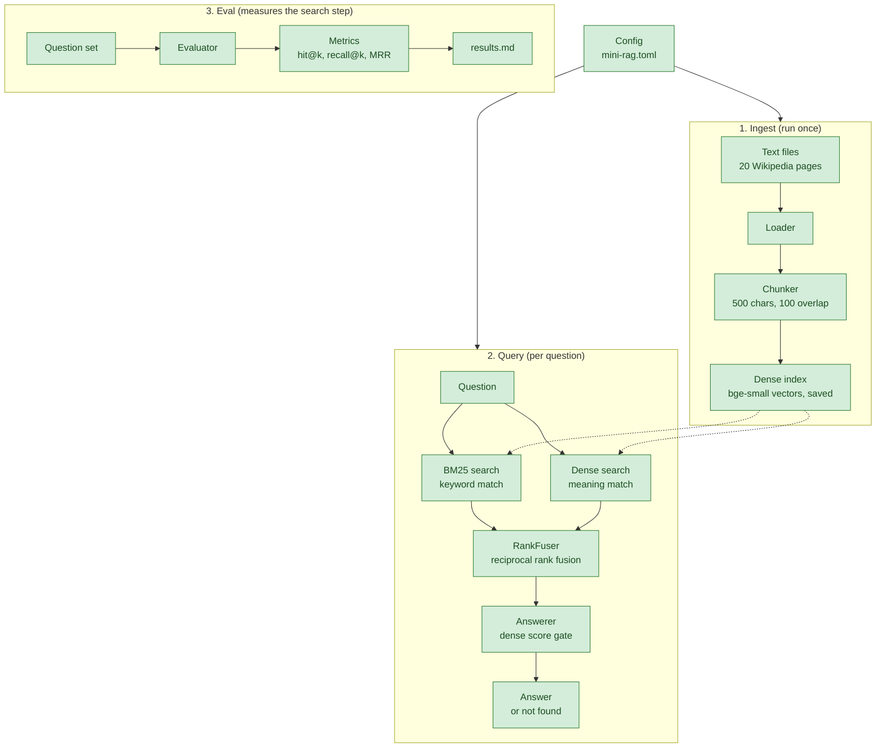

# How mini-rag works

This is a guided tour of the code: what runs during ingest, query and eval, which data types move between the steps, what each score means, and where files live. Class and method names refer to `src/mini_rag`. The reasons behind each choice are in [decisions.md](decisions.md).

## Overview



Legend: green means built and merged, yellow means not built yet. The dotted lines show that both searches read the saved index. The RankFuser step runs in hybrid mode only: dense mode skips BM25 search, and bm25 mode skips dense search (D31).

## Configuration

Before any command runs, `Cli.load_config()` finds `--config` among the arguments and `ConfigLoader.load()` reads that TOML file, or `mini-rag.toml` in the working directory when the option is left out, into a frozen `RagConfig`. A key left out of the file keeps its built-in default, a missing default file means all defaults, and a wrong type or an unknown key, section or kind is an error that names the key. `Cli.build_parser()` then uses the config's values as the option defaults, so the precedence is, highest first: the command-line option, the config file, the built-in default.

`ComponentFactory` turns the `[embedder]` and `[generator]` sections into objects. `embedder()` returns a `FastEmbedEmbedder` after checking the model name against fastembed's list of supported models, or for kind `custom` imports the named `Embedder` subclass and passes `[embedder.options]` as keyword arguments. `generator()` returns an `LlmClient` (kind `anthropic`), an `OpenAiCompatibleClient` (kind `openai_compatible`), `None` (kind `none`) or a custom `Generator` subclass. `Embedder` and `Generator` are the abstract base classes in `embedder.py` and `generator.py`. Tests pass an embedder or a client to `Cli` directly, which skips the factory.

## 1. Ingest

`uv run mini-rag ingest` calls `Cli.ingest`, which runs these steps in order:

1. `Chunker(i_size, i_overlap)` validates the chunk settings first, so bad values fail before any work is done.
2. `Loader(s_corpus_dir, t_extensions).load()` reads every non-empty `.txt` file in `data/corpus` (and `.md` files when `[corpus] extensions` names them) in file name order and returns one `Document` per file. Line endings are normalised to `\n`.
3. `Chunker.chunk_documents()` cuts every document into `Chunk` objects of 500 characters, each starting 400 characters after the last. On the included corpus that's 20 documents and 1,741 chunks.
4. `DenseIndex.build()` embeds all chunk texts through the configured embedder's `embed()`, by default `FastEmbedEmbedder`, and stores them as L2-normalised float32 rows in `arr_vectors`.
5. `DenseIndex.save()` writes `vectors.npy` and `chunks.json` into `.cache/index`.

Finally, `Cli.ingest` prints the counts, the settings, the index folder and the elapsed time. A missing corpus folder or an invalid setting prints an error and exits with code 2.

## 2. Query

`uv run mini-rag query "<question>"` calls `Cli.query`:

1. `DenseIndex.load()` reads `.cache/index` and checks the 2-D shape, the row count and the saved embedder name against the configured embedder's `s_name`. A different name stops the query with a message that asks for a new `ingest`.
2. `ComponentFactory.retriever()` builds the retriever for `[retrieval] mode`, or for `--mode` when it's given. In hybrid and bm25 modes `Bm25Index.build()` rebuilds the keyword index from the loaded chunks. It isn't saved separately. Dense mode builds no BM25 index.
3. `Answerer(f_threshold, b_gate_on_dense=...)` is created before searching, so an invalid `--threshold` fails early. `b_gate_on_dense` is `False` in bm25 mode and `True` otherwise.
4. `HybridRetriever.search(question, top_k)` asks each index for `max(20, top_k)` candidates: `Bm25Index.search()` tokenises the question with `Tokenizer` and keeps hits with a positive score, and `DenseIndex.search()` embeds the question with `query_embed()` and ranks every chunk by cosine score. In dense mode `DenseOnlyRetriever.search()` returns the top `top_k` dense hits instead, and in bm25 mode `Bm25OnlyRetriever.search()` returns the top `top_k` BM25 hits without embedding the question. Both skip step 5 and leave the fused score `None`.
5. `RankFuser.fuse()` merges the two lists with weighted reciprocal rank fusion. Each list has a weight, `f_bm25_weight` and `f_dense_weight` on `HybridRetriever`, and a chunk's fused score is the sum of weight / (60 + rank) over the lists that contain it. Both weights default to 1.0, which gives plain reciprocal rank fusion. `HybridRetriever` then attaches each chunk's own dense and BM25 score and keeps the first `top_k` hits as `HybridHit` objects.
6. `Cli.print_hit()` prints every hit with its marker and its three scores, with `-` for a missing score. In bm25 mode `Cli.query` then prints a note that the threshold isn't applied.
7. `Cli.answer()` picks the answerer. With `--generate`, `Cli.make_client()` asks `ComponentFactory.generator()` for the configured client. For kind `anthropic` it first checks that `ANTHROPIC_API_KEY` is set, and for kind `none`, the default, it prints that no generator is configured and returns no client. Without a client, or when the client fails, the extractive answerer is used and a note is printed.
8. `Answerer.answer()` applies the gate in `is_found()`. If the best dense score among the hits is below the threshold, the result is "Not found in the corpus." In bm25 mode `is_found()` skips the threshold and returns `True` when at least one hit exists. Otherwise `format_sources()` builds the extractive answer, or `LlmClient.generate()` writes one from the same sources.
9. `Cli.print_answer()` prints the answer text and a line such as `found: yes, written by a model: no`.

## 3. Eval

`uv run mini-rag eval` calls `Cli.eval`:

1. `QuestionLoader.load()` reads `eval/questions.json` and returns one `Question` per entry. A missing file, a malformed entry or a duplicate id prints an error and exits with code 2.
2. `Loader.load()` reads the corpus, and `QuestionValidator.validate()` checks every question against it. If there are problems, the command prints up to 10 of them and exits with code 2.
3. `Evaluator.run()` asks `EvalIndexStore.get_indexes()` for the indexes of each chunk size. The store loads the dense index from `.cache/eval/size_<size>_overlap_<overlap>` when `meta.json` matches the size, overlap, model name and corpus fingerprint. Otherwise it chunks, embeds and saves. It rebuilds the BM25 index from the chunks every time.
4. For each size, `Evaluator.run_size()` wraps the indexes in `Bm25Method`, `DenseMethod` and one `HybridMethod` per `FusionSetting`. All three implement `RetrievalMethod.rank()`. A plain run has a single fusion setting, the defaults of `HybridRetriever`.
5. Each method ranks every answerable question to depth 10. `Evaluator.outcome()` calls `RelevanceJudge.is_relevant()` on each returned chunk, which is true when the chunk contains the question's `must_contain` phrase, and records a `QuestionOutcome`.
6. `HybridMethod.hits()` then returns the top 5 hybrid hits for every question, answerable or not, and `Evaluator.best_dense()` keeps the highest dense score among them.
7. `ThresholdSweeper.sweep()` turns those best scores into one `SweepRow` per threshold from 0.40 to 0.80.
8. `ReportWriter.console_text()` gives the text that `Cli.eval` prints (Table 1 and Table 3), and `ReportWriter.write()` saves all tables to `eval/results.md`. `ReportTables` builds the tables and uses `MetricCalculator` for hit@k, recall@k and MRR.

With `--build-only`, `Cli.build_only` runs `Evaluator.prepare()` for each size and prints the chunk count, whether the index was built or loaded, and the elapsed seconds. It loads no questions and writes no report.

### The eval kit

Four more commands help a user build a question set. `eval-init` calls `QuestionStarter.write()`, which writes a starter file and refuses to replace one without `--force`. `eval-suggest` calls `SentenceSuggester.suggest()`, which picks sentences with a digit from the corpus, at most 5 per document. `eval-check` runs `QuestionValidator.validate()`; with `--lenient` it skips the set-level rules. `calibrate` builds a `Calibrator`, which loads or builds the index of the configured chunk size through `EvalIndexStore`, takes the best dense score of each question from the hybrid hits, and sweeps thresholds across the measured range with `ThresholdSweeper`. `EvalKit` prints the results for all four.

### The fusion grid

With `--fusion-grid`, `FusionGrid.settings()` supplies 12 fusion settings: k of 5, 10, 20 or 60, each with a BM25 weight of 1.0, 0.5 or 0.25 and a dense weight of 1.0. `Cli.eval` prints whether each index was loaded or built. `Evaluator.run_fusion()` then evaluates hybrid once per setting and stores a `FusionResult` in the `SizeResult`, while BM25 and dense are still ranked once per size. The tables in `eval/results.md` keep using the default setting, and `FusionGridWriter.write()` saves one row per setting to `fusion_grid.md` in the report's folder.

### How the sweep reads the dense score

The sweep uses the gate's own rule. `Answerer.is_found()` takes the highest non-None dense score among the hits and compares it with the threshold. `Evaluator.best_dense()` stores that same maximum for the top 5 hybrid hits of each question, and `ThresholdSweeper.is_found()` counts a question as found when the stored score is at least the threshold. A test runs both on the same hits and checks that they agree. The score belongs to whichever of the five hits has the highest cosine, which need not be the hit ranked first. The design and the measured results are in [decisions.md, D15](decisions.md#d15-eval-design) and [D19](decisions.md#d19-gate-sweep).

## Data types

All are frozen dataclasses except `EvalResult` and the `SizeResult` objects it holds.

| Type | Fields | Made by | Meaning |
|---|---|---|---|
| `Document` | `s_doc_id: str`, `s_text: str` | `Loader` | One corpus file. The id is the file name stem, such as `tokamak`. |
| `Chunk` | `s_doc_id: str`, `i_index: int`, `i_start: int`, `s_text: str` | `Chunker` | A slice of a document. `i_index` is its position within the document, and `i_start` is its character offset. Its identity is `(s_doc_id, i_index)`. |
| `SearchHit` | `obj_chunk: Chunk`, `f_score: float` | `Bm25Index`, `DenseIndex` | One result from a single retriever, with that retriever's score. |
| `HybridHit` | `obj_chunk: Chunk`, `f_rrf_score: float \| None`, `f_dense_score: float \| None`, `f_bm25_score: float \| None` | `HybridRetriever`, `DenseOnlyRetriever`, `Bm25OnlyRetriever` | One result. A score is `None` when that retriever didn't return the chunk among its candidates. `f_rrf_score` is `None` in dense and bm25 modes, which fuse nothing. |
| `Answer` | `s_text: str`, `l_sources: list[Chunk]`, `b_found: bool`, `b_generated: bool` | `Answerer` | The final answer. `l_sources` is empty when nothing was found, and `b_generated` is `True` only when a model wrote `s_text`. |
| `Question` | `s_id: str`, `s_text: str`, `b_answerable: bool`, `s_source_doc: str`, `s_must_contain: str`, `t_absent_terms: tuple[str, ...]`, `s_topic: str` | `QuestionLoader` | One eval question. Answerable questions fill `s_source_doc` and `s_must_contain`; unanswerable ones fill `t_absent_terms` and `s_topic`. Unused fields are `""` or an empty tuple. |
| `QuestionOutcome` | `s_id: str`, `i_first_rank: int \| None`, `i_total_relevant: int`, `d_found_at_k: dict[int, int]` | `Evaluator` | How one method did on one answerable question. `i_first_rank` is 1-based and `None` when no relevant chunk was in the top 10. `d_found_at_k` counts the relevant chunks in the top 1, 3 and 5. |
| `SweepRow` | `f_threshold: float`, `i_answerable_rejected: int`, `i_answerable_total: int`, `i_unanswerable_accepted: int`, `i_unanswerable_total: int` | `ThresholdSweeper` | The two kinds of gate error at one threshold. |
| `EvalResult` | `s_corpus_fingerprint: str`, `s_model_name: str`, `i_overlap: int`, `i_depth: int`, `i_gate_top_k: int`, `l_size_results: list[SizeResult]` | `Evaluator` | One eval run. Each `SizeResult` holds a chunk size's chunk count, the outcomes per method, the best dense score per question, the sweep rows and one `FusionResult` per fusion setting. |
| `FusionSetting` | `i_k: int`, `f_bm25_weight: float`, `f_dense_weight: float` | `FusionGrid`, `FusionSetting.default()` | One combination of fusion parameters. `s_label` gives its report name, such as `k=60 w=1.0/1.0`. |
| `FusionResult` | `obj_setting: FusionSetting`, `l_outcomes: list[QuestionOutcome]`, `d_best_dense: dict[str, float \| None]`, `l_sweep_rows: list[SweepRow]` | `Evaluator` | Hybrid's outcomes, gate scores and sweep under one fusion setting at one chunk size. |

## Scores

| Score | Range | What it means | Comparable with |
|---|---|---|---|
| BM25 | 0 upwards (non-positive hits are dropped) | Keyword overlap, weighted by how rare each word is and adjusted for chunk length. | Other BM25 scores for the same question only. The scale changes with the question's words. |
| Dense cosine | -1 to 1 | Similarity in meaning between the question vector and the chunk vector. | Other cosine scores from the same model. The range is fixed, so one threshold can be applied to every question, which is why the answer gate uses it. |
| Fused RRF | above 0, at most 2/61 (about 0.0328) | The sum of weight / (60 + rank) over the retrievers that returned the chunk, with both weights at their default of 1.0. Only the ranks matter. | Other fused scores for the same question only. It can't be compared with BM25 or cosine scores. |

## Where things live

All paths are relative to the project root.

| Path | Contents | In git |
|---|---|---|
| `data/corpus/` | The 20 article texts and `SOURCES.md` with each article's revision id and SHA-256 | yes |
| `data/corpus_titles.txt` | The article titles that `CorpusDownloader` fetches | yes |
| `.cache/index/` | `vectors.npy` (1,741 × 384 float32) and `chunks.json` (chunks plus model name), written by `ingest` | no |
| `.cache/eval/` | One folder per chunk setting, such as `size_500_overlap_100`, with `vectors.npy`, `chunks.json` and `meta.json`, written by `eval` | no |
| `.cache/fastembed/` | The quantised embedding model, in `models--Qdrant--bge-small-en-v1.5-onnx-Q`, about 64 MB | no |
| `.cache/huggingface/` | Hugging Face hub files, kept here by `HF_HOME` | no |
| `.cache/pytest-tmp/` | Temporary folders made by tests | no |
| `eval/questions.json` | The 25 answerable and 6 unanswerable eval questions | yes |
| `eval/results.md` | The report of the last eval run, written by `eval` | yes |
| `eval/fusion_grid.md` | One table per chunk size with a row per fusion setting, written by `eval --fusion-grid` | yes |
| `eval/my_questions.json` | A starter question file, written by `eval-init` | no, until you add it |
| `mini-rag.toml` | The config file every command reads; the shipped one reproduces the included example | yes |
| `examples/custom_embedder.py` | A minimal `Embedder` subclass to copy | yes |
| `examples/custom.toml` | A config that uses that embedder, with its own index and eval cache folders | yes |
| `.cache/index_custom/`, `.cache/eval_custom/` | The index and the eval cache written with `examples/custom.toml` | no |
| `docs/make-your-own.md` | How to swap the corpus, the models and the question set | yes |
| `scripts/env.ps1` | Sets `FASTEMBED_CACHE_PATH` and `HF_HOME` for the session | yes |
| `src/mini_rag/` | The package, one class per file | yes |
| `tests/` | The test suite and its fakes | yes |

## Worked example

The question "Who won the 1998 football World Cup?" has no answer in the corpus, since none of the 20 articles mentions the World Cup. Running it with the defaults (`--top-k 5`, `--threshold 0.55`) gives:

```text
1. [nuclear_safety_and_security#82]  dense 0.502  bm25 14.754  fused 0.0313
2. [chernobyl_disaster#158]  dense 0.495  bm25 8.279  fused 0.0288
3. [chernobyl_disaster#145]  dense 0.528  bm25 -  fused 0.0164
4. [tokamak#94]  dense -  bm25 12.990  fused 0.0161
5. [chernobyl_disaster#6]  dense 0.520  bm25 -  fused 0.0161
```

Here's how to read it.

- **BM25.** The tokens are `who`, `won`, `the`, `1998`, `football`, `world` and `cup`. Hit 1 contains "who", "1998" and "world" (from a passage on a 1998 coolant loss at a French reactor). Hit 4 contains "won" and "world". Both score high on words that have nothing to do with football.
- **Dense.** Hit 3 has the highest cosine score in the whole index, 0.528, but BM25 didn't return it, so its BM25 column shows `-`.
- **Fusion.** Hit 3 is first in the dense ranking alone, so its fused score is 1/61, about 0.0164. Hits 4 and 5 are each second in one ranking, so both get 1/62, about 0.0161. The tie keeps BM25's hit first, which is why `tokamak#94` comes before `chernobyl_disaster#6`. Hit 1 ranks first because both retrievers returned it.
- **Gate.** The top fused hit has a dense score of 0.502, but the gate reads the best dense score among all five hits, 0.528. That's below 0.55, so the output is "Not found in the corpus." with `found: no`, which is correct.

With `--threshold 0.5` the same hits come back, 0.528 is at least the threshold, and the five chunk texts are printed as the extractive answer. That's a wrong acceptance, and 0.5 was the default until the threshold sweep in `eval/results.md` counted both kinds of error at each threshold (see [decisions.md, D23](decisions.md#d23-threshold-decision)).
